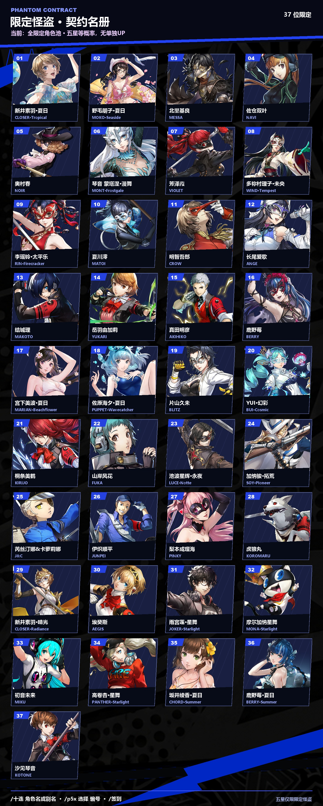
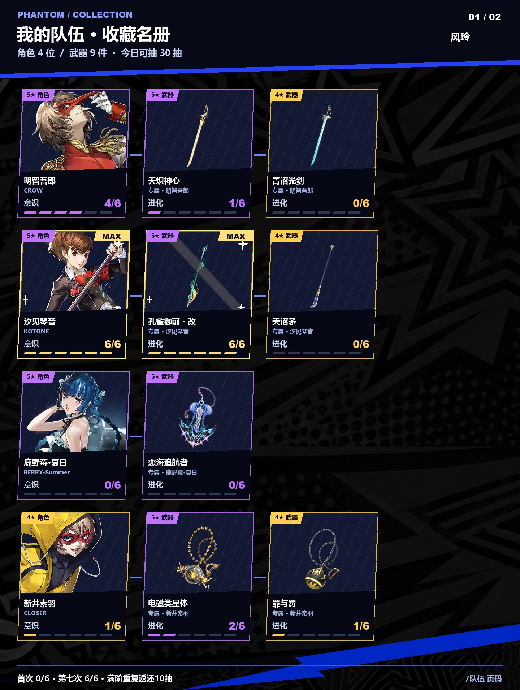
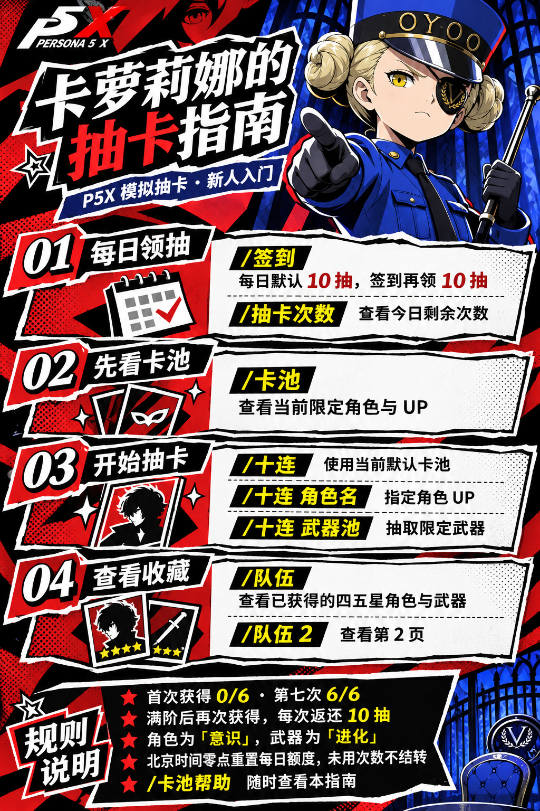

# P5X 模拟抽卡

适用于 [AstrBot](https://github.com/AstrBotDevs/AstrBot) 的《女神异闻录：夜幕魅影》模拟抽卡插件。支持限定角色、限定武器、每日签到和队伍收藏，以 P5X 风格图片展示抽卡结果。

[效果演示](#效果演示) · [快速开始](#快速开始) · [安装](#安装) · [指令](#指令) · [配置](#配置) · [常见问题](#常见问题)

> 本插件为非官方模拟娱乐项目，不连接游戏账号，不消耗或发放游戏内资源。实际可抽角色以插件 `/卡池` 为准。

## 功能

- **图片抽卡**：角色与专属人格面具分层展示，结果页显示头像、昵称、保底进度和累计抽数。
- **限定卡池**：可抽全限定角色／武器池，也可指定角色或专武 UP，支持角色名、代号和部分别名。
- **每日额度**：默认每天 10 抽，签到再领 10 抽，北京时间零点重置。
- **队伍收藏**：记录四五星角色和武器，展示意识／进化；角色与已拥有的专武相邻排列。
- **满阶奖励**：首次获得为 `0/6`，第七次达到 `6/6` 并显示闪光；此后每次重复获得返还 10 抽。
- **卡池与教程**：`/卡池` 输出合并卡面目录，`/卡池帮助` 输出卡萝莉娜图片教程。
- **管理功能**：通过白名单授权管理员，为所有已登记用户追加抽数。

## 效果演示

以下为插件渲染器生成的演示图片，使用预设抽取结果和收藏数据，不代表实际抽取概率或用户账号数据。卡池内容以当前安装版本的 `/卡池` 为准。

### 十连结果

`/十连`：角色与专属人格面具分层展示，底部显示昵称、今日可抽次数、保底进度和累计抽数。本例头像使用昵称占位。


<details>
<summary>查看卡池目录演示（点击展开）</summary>

`/卡池`：将限定角色卡面合并为一张长图，显示角色名称与编号，可配合 `/p5x 选择 编号` 设置个人默认池。



</details>

<details>
<summary>查看队伍收藏演示（点击展开）</summary>

`/队伍`：展示已获得的四五星角色和武器、意识／进化进度。对应专武紧邻角色，满阶条目显示金色闪光与 MAX 标记。本图为多页收藏中的第一页。



</details>

<details>
<summary>查看四十连抽单图演示（点击展开）</summary>

`/四十连抽`：每十抽一行，四行合成一张图，只发送一条图片消息。顶部为整次统计，每行显示批次范围，用户信息使用最终结算值。


</details>

<details>
<summary>查看四五星光效优化对比（点击展开）</summary>

v0.3.4：四星补强金色边缘柔光、亮芯与星芒；五星增强紫色辉光、局部亮边和顶底背光。光晕集中在卡边及顶底，保留角色面部与卡间黑色分隔，低星不附加光效。

| 调整前 | 调整后 |
| --- | --- |
|  |  |

</details>

<details>
<summary>查看当前柔和泛光效果（v0.3.5，点击展开）</summary>

四星为暖金泛光，五星为紫色泛光。泛光全部位于卡面外侧与背后，向外扩散，不覆盖人物、人格面具或卡面内部；不叠加星形或碎钻图标。


</details>

## 快速开始

安装并重载插件后，依次发送：

```text
/卡池帮助
/签到
/卡池
/十连
/队伍
```

不带参数的 `/十连` 使用个人默认卡池；尚未设置时使用插件配置，初始为全限定角色池。

```text
/十连 哈姆子
/十连 武器池
/p5x 选择 全角色池
/抽卡次数
```

以上分别表示：本次抽汐见琴音 UP、抽全限定武器池、将个人默认切回全限定角色池、查询今日额度。指定目标只影响本次抽取；需要保存默认选择时使用 `/p5x 选择`。

<details>
<summary>查看卡萝莉娜新手教程图</summary>



教程中的抽数为默认配置，实际额度以 `/抽卡次数` 为准。

</details>

## 安装

### 环境要求

- AstrBot **4.27.5 或更新版本**。
- Python 依赖：`Pillow>=10.0.0`，见 [requirements.txt](requirements.txt)。
- 图片渲染需要可用的中文字体；自动查找失败时可配置 `font_path`。

### 方法一：通过仓库链接安装

在 AstrBot WebUI 的插件管理页打开安装窗口，**只填写仓库链接，不要同时选择文件**：

```text
https://github.com/Yamabuki-Kirio/astrbot_plugin_p5x_gacha_sim
```

安装完成后重载插件。已安装的用户可在插件管理页尝试更新。

### 方法二：手动安装

本项目内置较多立绘素材，v0.3.1 完整 ZIP 约 **194 MiB**。网页上传可能受到 AstrBot 或反向代理的大小、超时限制；遇到上传失败时可手动安装。

1. 从仓库页面的 **Code → Download ZIP** 下载源码，或使用维护者提供的完整安装包。
2. 解压，将包含 `main.py` 和 `metadata.yaml` 的文件夹重命名为 `astrbot_plugin_p5x_gacha_sim`。
3. 将该文件夹放入 **AstrBot 实际运行环境**的 `data/plugins/` 目录。
4. 在 AstrBot 使用的 Python 环境中安装依赖，再重启 AstrBot。

目录应为：

```text
data/
└── plugins/
    └── astrbot_plugin_p5x_gacha_sim/
        ├── main.py
        ├── metadata.yaml
        ├── _conf_schema.json
        ├── requirements.txt
        ├── assets/
        ├── data/
        └── src/
```

注意不要多套一层同名文件夹。Docker 部署应操作挂载到容器的 `data/plugins/` 目录；服务器部署需将文件上传到服务器。

在 AstrBot 根目录、使用其 Python 环境执行：

```bash
python -m pip install -r data/plugins/astrbot_plugin_p5x_gacha_sim/requirements.txt
```

也可以在 AstrBot 根目录通过 Git 安装：

```bash
git clone https://github.com/Yamabuki-Kirio/astrbot_plugin_p5x_gacha_sim.git data/plugins/astrbot_plugin_p5x_gacha_sim
```

启动日志出现 `P5X 抽卡插件已就绪` 后，发送 `/卡池帮助` 测试。

### 更新与备份

手动覆盖更新前，先停止 AstrBot 并备份旧插件文件夹及用户数据库。新版插件文件夹内的 `assets/`、`data/` 和 `src/` 都需要更新。

用户数据通过 AstrBot 的插件数据目录保存，通常位于：

```text
data/plugin_data/astrbot_plugin_p5x_gacha_sim/p5x_gacha.sqlite3
```

实际位置由 `StarTools.get_data_dir()` 决定。**请保留此数据库**，其中存有保底、抽卡记录、每日额度、队伍和个人默认卡池。插件源码内的 `data/` 是卡池配置与条目数据，和用户数据库不是同一目录。

升级时会从已有历史一次性恢复可识别的四五星收藏，最多恢复到 `6/6`；不会补发历史满阶返还。未记录的旧抽取结果无法恢复。

## 指令

下表按默认 `/` 前缀书写；`[]` 表示可选参数，`<>` 表示必填参数，实际使用时不用输入括号。

### 常用指令

| 指令 | 作用 |
| --- | --- |
| `/卡池帮助` | 发送卡萝莉娜图片教程 |
| `/卡池` | 一张长图查看当前限定角色目录、编号及当前 UP |
| `/签到` | 领取当日签到奖励，默认 10 抽，每天一次 |
| `/抽卡次数` | 查看今日剩余抽数、已抽次数和签到状态 |
| `/二十连抽 [角色名或卡池]` | 一次抽取 20 次，合成一张含 2 行十连的结果图 |
| `/三十连抽 [角色名或卡池]` | 一次抽取 30 次，合成一张含 3 行十连的结果图 |
| `/四十连抽 [角色名或卡池]` | 一次抽取 40 次，合成一张含 4 行十连的结果图 |
| `/十连` | 在当前默认卡池抽取十次 |
| `/十连 <角色名或别名>` | 本次抽取指定角色 UP 池 |
| `/十连 武器池` | 抽取全限定武器池 |
| `/十连 武器 <角色名或武器名>` | 本次抽取指定专武 UP 池 |
| `/队伍 [页码]` | 查看四五星收藏、意识／进化和专武；不填页码发送全部页 |

以上快捷指令也有 `/p5x` 形式，例如 `/p5x 卡池帮助`、`/p5x 卡池`、`/p5x 签到`、`/p5x 次数`、`/p5x 十连`、`/p5x 队伍`。

### 批量连抽（20／30／40 抽）

```text
/二十连抽
/三十连抽 哈姆子
/四十连抽 武器池
/二十连抽 武器 哈姆子
/p5x 四十连抽 鬼太郎
```

沿用十连的默认池、指定角色和指定武器语法，不改变个人默认。也支持 `/p5x 二十连抽`、`/p5x 三十连抽`、`/p5x 四十连抽`；开启无斜杠兼容后可省略 `/`。仅支持固定的 20、30、40 抽，不接受五十连抽或任意数量。

- 发起前必须有足够的整次额度。默认基础 10 抽加签到 10 抽可进行二十连抽；三十／四十连抽需要额外奖励、管理员追加或调整配置，不自动赠送额度。
- 先统一检查额度，在一个事务内按实际抽取顺序结算所有结果。额度不足或结算异常时整次取消，已写入的额度、保底、历史与收藏一起回滚。
- 四星和五星保底、UP 保底连续计算，不会在每十抽的分组处重置；满阶返还按每次获得依次累计，但不能预支本次可能获得的返还来发起抽取。
- 每十抽一行，共 2／3／4 行，纵向合并为一张完整图片，只发送一条图片消息。顶部显示整次统计，各行标注组数和序号范围；用户信息栏显示本次全部抽取后的最终保底、累计与剩余额度。
- 关闭渲染或合图失败时，输出完整文字结果；不会重新抽取或重复扣除额度。消息发送失败时，已结算数据仍保留，可通过队伍、记录和保底查询。

### 不带斜杠的指令（可选）

在插件配置中开启 **兼容不带斜杠的指令**（`enable_plain_commands`），保存并重载后，可以直接发送：

```text
十连
十连 哈姆子
十连 武器池
卡池
卡池帮助
签到
抽卡次数
队伍
队伍 2
p5x 保底
```

默认关闭，原有带 `/` 的指令始终保留。开启后，常用快捷指令及 `p5x` 子指令均支持省略 `/`；`刷新` 仍需管理员白名单权限。指令名与参数之间用空格分隔，只识别从消息开头开始的完整指令，不匹配普通聊天中夹带的关键词。

无斜杠的「签到」「刷新」等名称可能与其他插件重名，请按需开启。该开关只控制本插件新增的兼容入口；AstrBot 自身的唤醒前缀、私聊或 @ 唤醒行为仍按宿主设置生效。

### 其他指令

| 指令 | 作用 |
| --- | --- |
| `/p5x 帮助` | 查看文字指令列表 |
| `/p5x 选择 <角色名或卡池编号>` | 保存个人默认卡池，编号见 `/卡池` |
| `/p5x 选择 全角色池` | 将个人默认切换为全限定角色池 |
| `/p5x 选择 武器池` | 将个人默认切换为全限定武器池 |
| `/p5x 单抽 [角色名或卡池]` | 消耗 1 抽额度进行单抽 |
| `/p5x 保底 [角色名或卡池]` | 查看当前保底、共享累计与剩余额度 |
| `/p5x 记录 [页码]` | 查看四五星角色／武器的抽取记录，每页 10 条 |
| `/p5x 自选 <角色名>` | 在支持自选的常驻池满足 300 抽条件后领取自选 |
| `/p5x 榜单` | 查看当前平台的五星数量排行 |

**“哈姆子”仅指汐见琴音（KOTONE／P3P 女主）**，不是琴音·蒙塔涅（MONT），也不是蒙塔涅·漫舞。只输入“琴音”存在歧义，请使用完整姓名。指定 UP 不代表所有抽取结果都是该角色，四星候选仍可能出现琴音·蒙塔涅。

名称存在歧义时，按提示使用完整名称。不同形态独立匹配，具体支持范围以当前数据为准。

### 管理员指令

| 指令 | 作用 |
| --- | --- |
| `/刷新` 或 `/p5x 刷新` | 给所有已登记用户的当日可抽次数各增加 10 抽 |

仅 `admin_whitelist` 内的用户可执行，群主、群管理员或 AstrBot 管理员身份不会自动获得此权限。默认白名单为空，无人可执行。

此命令影响**所有已登记用户，不限当前群**，可以重复使用：`0 → 10`、`10 → 20`、`20 → 30`。它不重置签到、已抽次数或保底；奖励与签到、满阶返还叠加，未使用部分在北京时间零点清除。

## 抽卡规则

### 每日额度

- 默认每日基础额度为 **10 抽**，签到额外 **10 抽**；管理员追加和满阶重复返还可提供更多抽数。
- 同一平台账号在不同群共用额度，所有卡池及单抽／十连共用。
- 北京时间 **00:00（UTC+8）**按新日期重置额度与签到状态，昨日未使用的次数不结转。
- 零点刷新不影响保底、累计已抽、历史、队伍和个人默认卡池。
- 抽数不足时整次拒绝；必须先有足够额度，不能预支本次可能获得的返还。

### 卡池与保底

- 全限定角色池内的五星等概率，无单独 UP；指定角色池以该角色作为唯一五星 UP。
- 所有限定角色池共享保底和该类型累计抽数；限定武器池另行共享，常驻池独立。
- 角色五星硬保底为 **80 抽**，武器为 **70 抽**，具体概率和 UP 比例以 [卡池配置](data/banners.json) 为准。
- 抽到五星立即重置五星保底；同一十连中后续抽取继续计数。累计抽数不会随出五星重置。
- 全限定池不消耗已保存的指定池 UP 大保底资格，该资格在后续指定池中使用。
- 默认池优先级：**本次显式指定 > 个人选择 > 插件默认配置**。

本插件的卡池范围和部分低星数据属于模拟设定，不代表官方实时契约。**星舞龙司（SKULL·Starlight）当前暂时下架**，不出现在可抽池和卡池目录中。

### 队伍、意识与进化

| 同一条目的获得次数 | 展示阶段 | 额外奖励 |
| --- | --- | --- |
| 第 1 次 | `0/6` | 无 |
| 第 2～6 次 | `1/6`～`5/6` | 无 |
| 第 7 次 | `6/6`，显示满阶闪光 | 无 |
| 第 8 次及以后 | 保持 `6/6` | 每次返还 10 抽 |

仅收藏四五星角色和武器，角色称为「意识」，武器称为「进化」。不同角色、武器与形态分别计数；已拥有的对应专武会紧邻角色展示。收藏跨日期保存，返还抽数加入当天额度，不计入累计已抽次数。

## 配置

在 AstrBot 插件管理页打开本插件配置，修改后重载。配置定义见 [_conf_schema.json](_conf_schema.json)。

| 配置项 | 默认值 | 说明 |
| --- | --- | --- |
| `enable_plain_commands` | `false` | 兼容不带 `/` 的快捷指令与 `p5x` 子指令，默认关闭 |
| `enable_rendering` | `true` | 启用结果、卡池和队伍图片；关闭后使用文字。静态 `/卡池帮助` 仍发送图片 |
| `enable_history_recording` | `true` | 保存四五星逐条记录；关闭仍保存保底、额度和队伍，并计算满阶返还 |
| `daily_draw_limit` | `10` | 每日基础抽数，非负整数 |
| `daily_signin_bonus` | `10` | 每日签到奖励抽数，非负整数 |
| `admin_whitelist` | `[]` | 可执行 `/刷新` 的用户 ID 列表，QQ 平台填写 QQ 号 |
| `default_pool_type` | `character` | 默认类型：`character` 为角色，`weapon` 为武器 |
| `selected_character` | 空字符串 | 默认 UP 角色，留空使用全限定角色池 |
| `selected_weapon` | 空字符串 | 默认 UP 武器，支持武器名或所属角色名；留空使用全限定武器池 |
| `default_banner` | 空字符串 | 旧版默认池兼容配置，通常留空 |
| `font_path` | 空字符串 | 中文字体绝对路径，留空自动查找；Docker 内应填写容器路径 |

管理员白名单填写示例（替换为自己的 QQ 号）：

```json
{
  "admin_whitelist": ["123456789", "987654321"]
}
```

## 常见问题

### 文件安装提示 `Failed to fetch`

这是请求失败提示，仅凭该信息无法确定具体原因。完整素材包较大，可能触发上传大小限制、代理超时或连接中断。优先尝试仓库链接安装，或按上文手动解压安装；进一步排查需查看 AstrBot 日志和浏览器网络请求。

### 提示「请不要同时填写插件链接和上传文件」

安装窗口同时保留了链接和文件。清空其中一项，或刷新 WebUI 后重新打开安装窗口，只选择一种方式。

### 不出图、中文乱码或字符显示为方框

先确认 `enable_rendering` 已开启、Pillow 已安装，再检查 AstrBot 日志和中文字体。必要时设置 `font_path` 为运行环境中实际存在的字体路径。渲染失败时会回退文字结果。

### QQ 头像没有显示

在可识别的 OneBot／aiocqhttp／LLOneBot 平台上，插件会按数字 QQ 号获取头像并缓存 24 小时。网络不可用或平台不匹配时使用默认头像，不影响抽卡；昵称来自消息事件。

### 更新后没有新指令

确认更新的是 AstrBot 实际加载的插件目录，`main.py` 没有多套一层目录，随后重启 AstrBot。检查启动日志有无依赖或初始化错误。

### 为什么没有星舞龙司？

该角色当前暂时下架，等待维护者后续更新。已有数据和历史保留，不需要删除用户数据库。

## 维护与开发

- [更新记录：v0.3.5](UPDATE-v0.3.5.md) · [v0.3.4](UPDATE-v0.3.4.md) · [v0.3.3](UPDATE-v0.3.3.md) · [v0.3.2](UPDATE-v0.3.2.md) · [v0.3.1](UPDATE-v0.3.1.md) · [v0.3.0](UPDATE-v0.3.0.md) · [v0.2.1](UPDATE-v0.2.1.md) · [v0.2.0](UPDATE-v0.2.0.md)
- [素材说明](assets/README.md) · [图层说明](assets/character_layers/README.md) · [数据与素材准备清单](docs/准备清单.md)
- 卡池配置：`data/banners.json`；角色／武器条目：`data/items/`。
- 角色定位：`assets/character_layers/placement.json`；低星人格面具定位：`assets/persona_placement.json`。
- 临时下架名单：`data/excluded_characters.json`。恢复前补齐素材并检查数据，删除对应下架条目后重载。

修改配置或数据前请备份。调整卡池时需保证概率之和为 1、UP 条目属于候选池、各稀有度候选有效；限定池也会根据角色条目生成，修改后应检查实际 `/卡池` 输出。

```bash
python -m pip install -r requirements.txt
python -m pip install pytest
python -m pytest tests -q
python tools/render_demo.py
python tools/review_placements.py
```

当前已进行本地机制、持久化、命令适配与图片渲染测试；尚未完成真实 AstrBot／QQ 消息环境的全面验证。图片为程序渲染的近似表现，部分低星数据仍为模拟或占位，详见素材与准备清单。

## 致谢与素材说明

- [AstrBot](https://github.com/AstrBotDevs/AstrBot)：机器人框架。
- [astrbot_plugin_ww_gacha_sim](https://github.com/HoshiKurea/astrbot_plugin_ww_gacha_sim)：架构参考。
- [astrbot_plugin_pic_toolbox](https://github.com/Yamabuki-Kirio/astrbot_plugin_pic_toolbox)：消息监听与无斜杠指令解析方式参考。
- 「夜幕档案」每日运势功能：QQ 头像与昵称获取方式参考。
- 角色、人格面具、武器和游戏界面素材的权利归原权利人所有；本项目为非官方同人模拟工具，与官方无关。教程图含 AI 生成插画。

遇到问题时请通过 [Issues](https://github.com/Yamabuki-Kirio/astrbot_plugin_p5x_gacha_sim/issues) 提交 AstrBot 版本、插件版本、复现步骤与相关错误日志；请先遮盖账号凭据和其他敏感信息。
